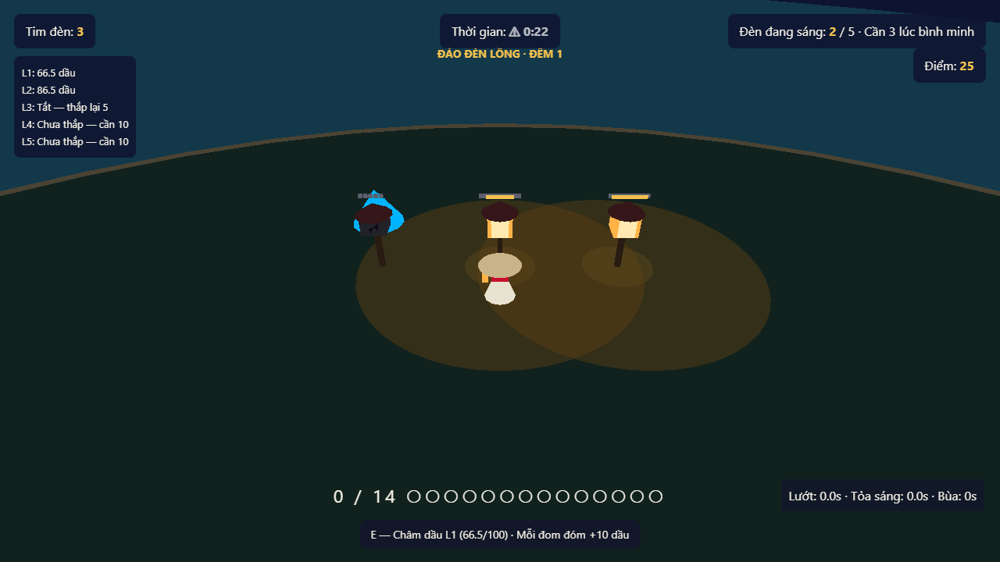

# Đảo Đèn Lồng v1.0.0 — Phase 4

[▶ Video demo MP4 dưới5phút](docs/demo/demo.mp4) · [Báo cáo phát hành](PHASE-4-REPORT.md) · [Retro4phase](docs/notes/RETRO.md)



Yêu cầu hệ thống: Node.js22+; trình duyệt WebGL2 (Chrome/Edge/Chromium hoặc trình duyệt tương đương), màn hình1280×720 trở lên. Windows/macOS/Linux. Lệnh bench cần Chrome/Chromium đã cài; đặt biến CHROME_PATH nếu không tìm được. Không cần npm install hoặc thư viện bên ngoài. Gói web trong Release có cùng cách chạy2lệnh bên dưới. Dữ liệu cá nhân bảng điểm không nằm trong gói.

## Bổ sung Phase 4

- Menu có Bảng xếp hạng. Sau khi thua hoặc thắng Đêm3, nhập tên3–12ký tự A–Z/a–z/0–9/_ để lưu tổng điểm các Đêm thắng. Top10 lưu tại data/leaderboard.json, còn sau đóng/mở; CLI export dùng cùng file.
- Cài đặt đổi được mọi phím, phát hiện trùng, khôi phục mặc định và lưu lại; hỗ trợ bộ gõ bằng mã phím vật lý. Giảm chuyển động tắt flash, không có camera shake; chữ mặc định18px và chữ lớn22.5px.
- Chỉ báo hình ảnh cho shade spawn/hướng ở mép, gió báo trước,10s cuối và đèn yếu. Cài đặt màu từ Phase3 tiếp tục được lưu.

### Test, headless, benchmark, soak và xuất bảng điểm

```bash
node tests/phase1/verify.mjs
node tests/phase4/verify.mjs
node tests/phase4/leaderboard.mjs
node tests/phase4/browser.mjs
node src/headless.mjs --seed 42 --night 1 --ticks 600 --out headless.jsonl
node scripts/bench.mjs --seed 42 --duration 30 --out bench.json
node --expose-gc scripts/soak.mjs --seed 7 --nights 10 --out soak.json
node scripts/serve.mjs --export-leaderboard out.json
```

Bench mở cửa sổ1280×720, camera chuẩn, đúng200wander/100mote/3đèn100dầu. Bỏ3s khởi động rồi đo30s. Chỉ cảnh bench tắt spawn/hit/pickup/fuel/game-over, giữ hiệu ứng và ánh sáng thật. Bench/soak không thêm thực thể hoặc hiệu ứng sáng tạo ngoài lõi. bench.frames.json chứa dt thật để tính lại số đo; bench.scene.json ghi cấu hình cảnh.

Web requestAnimationFrame chịu vsync của trình duyệt/màn hình; không tắt được qua ứng dụng nên vsync_off=false. peak_mem_mb=null vì trình duyệt chạy nhiều tiến trình, không có API web đo RSS toàn renderer một cách tin cậy. Soak đo RSS Node trong cùng tiến trình; --expose-gc cho phép GC tại cả hai mốc đo đối xứng, không khởi tạo tiến trình cho mỗi Đêm. Seed đêm đầu7, sau đó8…16 (i bắt đầu0). Các xác suất hành động độc lập theo tick, không phát input pause.

Giới hạn đo: số trên máy này chỉ để tham khảo; máy chấm của giảng viên mới quyết định ngưỡng. Chưa xác nhận trực tiếp trên macOS/Linux, nhưng runtime game dùng Node/WebGL thuần. Test browser tự dùng dữ liệu bảng điểm tạm, không sửa dữ liệu người chơi.

### Tạo gói và kiểm tra demo

```bash
node scripts/package.mjs
node tests/phase4/media.mjs
```

Gói: dist/dao-den-long-v1.0.0-web.zip. Giải nén, mở terminal trong thư mục gói, chạy build rồi serve. Tài liệu/retro và video có trong docs. Video do MediaRecorder quay canvas game thật, có phụ đề và output tiến trình test thật; phần bench/soak trình bày kết quả đo thật đã lưu, không giả là một lượt chơi3Đêm hoàn chỉnh. Không có lời dẫn âm thanh.

---

Game 3D ba Đêm, WebGL2 + JavaScript thuần. Mây phải **giữ đảo sáng tới bình minh**: cuối Đêm còn sống và ít nhất3/5,4/6,5/7đèn sáng. Thắp hết đèn không thắng sớm. Logic bản chơi và headless dùng chung `src/core.mjs`.

## Cài đặt và chạy

Node.js 18+ và trình duyệt hỗ trợ WebGL2 trên macOS/Linux/Windows. Không cần thư viện hoặc tải asset ngoài.

```bash
node scripts/build.mjs
node scripts/serve.mjs
```

Mở http://127.0.0.1:4173/. Menu → giới thiệu → bắt đầu Đêm 1. Thắng để tiếp tục Đêm kế; thua được chơi lại Đêm đó. Thắng Đêm 3 hiện Bình Minh và tổng điểm các Đêm thắng. Để kiểm tra riêng bản đồ: `http://127.0.0.1:4173/?night=2` hoặc `?night=3`.

Để xem nhanh cơ chế dầu và đèn yếu, mở `http://127.0.0.1:4173/?scene=fuel&night=1`. Đây là cảnh kiểm tra riêng với trạng thái dựng sẵn, không phải màn mặc định.

## Điều khiển

| Phím/thao tác | Hành động |
|---|---|
| W A S D | Di chuyển theo camera |
| Space | Nhảy |
| Shift | Lướt |
| E (hoặc F) | Nạp đèn ở gần |
| Q | Tỏa Sáng |
| Kéo chuột trái hoặc ← → | Xoay camera |
| Esc / P | Tạm dừng, cài đặt, tiếp tục, chơi lại hoặc về menu |
| R | Chơi lại Đêm hiện tại |

Game ưu tiên phím vật lý nên WASD không phụ thuộc ký tự chữ mà bộ gõ tạo ra; lần nhấn nhanh được giữ tới tick kế tiếp. Canvas tự nhận focus sau menu/pause. Nếu bộ gõ tiếng Việt vẫn chặn phím ở cấp hệ điều hành, chuyển bộ gõ sang chế độ tiếng Anh khi chơi.

Đom đóm nhặt tự động trong1m. Sức chứa bắt đầu10, tăng2 mỗi lần thắp thành công (kể cả thắp lại), tối đa20. Đèn chưa từng sáng cần10, thắp lại cần5, có thể nạp từng phần. Mỗi lần thắp cấp100dầu; hao1/giây. E tại đèn sáng để châm10dầu/mote. Dầu dưới30 mất vùng an toàn và nhấp nháy1Hz; hết dầu thì tắt. Đêm kéo dài240/270/300giây.

Pulse tốn3, cooldown3s. Dash14m/s trong0.2s, cooldown1.5s. Bùa Gió kéo dài10s: chạy7.2m/s, dash không cooldown (vẫn phải nhấn lại).

Bóng Mực chạm mất1lửa, rơi một nửa đom đóm; có1.5s bất tử. Rơi khỏi đảo mất hết đom đóm, mất1lửa và chờ1s hồi sinh nếu còn sống. Gió Lạc không trừ lửa nhưng cướp tối đa3; pulse có thể lấy lại đom đóm chúng đang mang. Bóng Mực wander tìm đèn yếu để hút5dầu/giây/con; pulse ngắt hút. Đèn sáng có dầu≥30 tạo vùng an toàn6m, không ngăn Gió Lạc.

## Điểm chuẩn Phase 3

+5 mỗi đom đóm **nạp** (thắp mới/thắp lại/châm dầu), +100 thắp đầu, +40 thắp lại. Pulse trúng Bóng Mực +5, hoặc **tổng15** nếu nó đang hút dầu. Thắng bình minh cộng `50 + floor(fuel)` cho mỗi đèn đang sáng và50/lửa còn lại; không thưởng thời gian. Tổng hành trình chỉ cộng điểm các Đêm thắng. Chết luôn thua trước khi xét ngưỡng đèn, kể cả tick bình minh.

Trong Cài đặt có “Bảng màu dễ phân biệt”, lưu giữa các lần mở. Viền/mắt Bóng Mực chuyển xanh dương, cảnh báo trắng và⚠. Đèn tắt luôn xẹp20% và có vết rách để phân biệt không cần màu.

## Test Contract v1.2

```bash
node src/headless.mjs --seed 42 --night 2 --ticks 1200 --snapshot-every 10 --out night2.jsonl
node tests/phase1/verify.mjs
node tests/phase3/verify.mjs --evidence
```

`--night` nhận1/2/3. Có thể thêm `--scenario file.json --inputs file.json`. Scenario và input mẫu kèm output thật ở [bằng chứng Phase 3](docs/proof/phase-3/). Tick vẫn tăng khi pause, sim_tick/dầu/hút đứng yên. Lỗi file trả mã2 và stderr. Lõi dùng RNG seed và cố định60Hz.

Lệnh kiểm tra Phase1 hiện chạy hồi quy với luật1.2 và bộ test Phase3. Test cũ đã được thay đúng các kỳ vọng bị Ticket-03 thay thế, có lý do ở [CHANGELOG](CHANGELOG.md). Các tag phase-1/phase-2 và bằng chứng lịch sử được giữ nguyên.

## Kiểm chứng và phạm vi

[Báo cáo Phase 3](PHASE-3-REPORT.md) · [ADR](docs/notes/ADR-003-lantern-fuel.md) · [Ticket-03](docs/requirements/Ticket-03.md) · [Lịch sử Phase2](PHASE-2-REPORT.md). Kiểm tra browser: `node tests/phase3/browser.mjs` tự mở server4184 và Chrome profile tạm (đặt CHROME_PATH nếu cần). Không dùng server test này cho truy cập internet. Kết quả FPS là mẫu đo trên máy hiện tại.

## Sáng tạo của tôi

Ánh sáng ấm quanh đèn đủ dầu, nón lá gắn đèn nhỏ, vùng sáng tăng/giảm theo số đèn đang sáng. Các tầng cao/tháp mờ đi khi Mây ở dưới để không che nhân vật. Những hiệu ứng này chỉ nằm ở renderer và đã được điều chỉnh theo luật dầu mới.

## Tài liệu và nguồn

[Hướng dẫn lab](docs/requirements/LAB-README.md) · [PRD-0](docs/requirements/PRD-0.txt) · [Quy định](RULES.md) · [Rubric](RUBRIC.md) · [Credits](CREDITS.md). Tag Phase1 giữ nguyên lịch sử bản v1.0.
